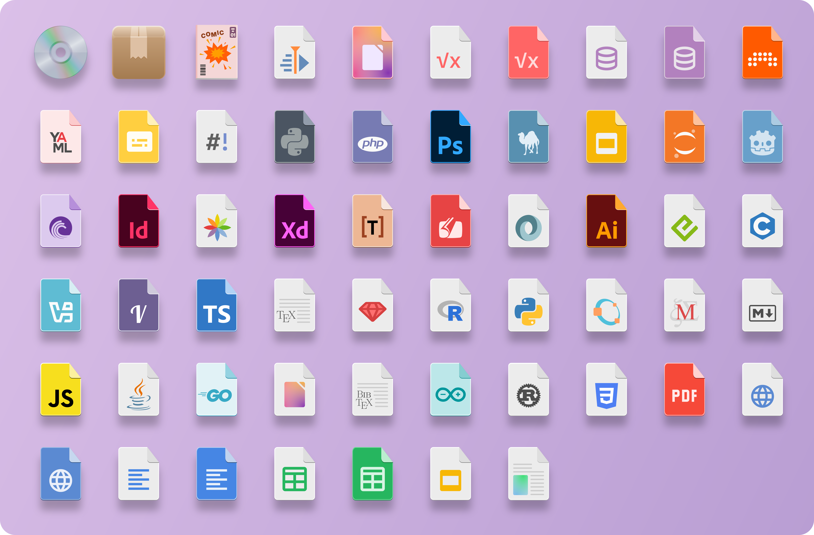

<h1 align="center"> Neuwaita </h1>
<h4 align="center"> A different take on the Adwaita theme. </h4>

Neuwaita was originally created by **RusticBard** (github.com/RusticBard/Neuwaita, no longer available), with contributions from the community.
This repository continues the project from the last public version ([commit 31e918f](https://github.com/xydani/Neuwaita/commit/31e918f), March 2026) and adds new icons and fixes.

> [!NOTE]
> This project is maintained with the help of [Claude Code](https://claude.com/claude-code), Anthropic's AI coding assistant.




Neuwaita is a scalable (SVG) icon theme for Linux desktops, built for GNOME. It covers apps, file types, folders and some system tray icons. Apps it doesn't cover fall back to Adwaita, hicolor and Breeze.

## Installation
### With git (recommended, easy to update)
User installation:
```sh
git clone https://github.com/xydani/Neuwaita.git ~/.local/share/icons/Neuwaita
```
System-wide installation:
```sh
sudo git clone https://github.com/xydani/Neuwaita.git /usr/share/icons/Neuwaita
```

### With the install script
Clone or [download](https://github.com/xydani/Neuwaita/archive/refs/heads/main.zip) the repository anywhere, then from its folder run:
```sh
./install.sh                  # current user (~/.local/share/icons/Neuwaita)
sudo ./install.sh --system    # system-wide (/usr/share/icons/Neuwaita)
./install.sh --watch-accent   # current user + folders follow the GNOME accent color
./install.sh --uninstall      # remove (add --system for the system-wide install)
```
The script copies only the theme files, keeps the folder color you chose and replaces any previous Neuwaita installation in the same place.

### Activating the theme
Select Neuwaita in GNOME Tweaks, or run:
```sh
gsettings set org.gnome.desktop.interface icon-theme 'Neuwaita'
```
**Log out and back in** after installing or updating, so that the shell, the tray and all running apps pick up the new icons.

## Updating
- **git installation:**
  ```sh
  git -C ~/.local/share/icons/Neuwaita pull         # user installation
  sudo git -C /usr/share/icons/Neuwaita pull        # system-wide installation
  ```
  If you changed the folder color, `git pull` may refuse to update `folder.svg`. Run `git -C <install dir> checkout scalable/places/folder.svg`, pull, then set the color again.
- **install script:** get the new version (`git pull` or download it again) and run `./install.sh` again.

Then log out and back in.

## Customize folder colors
Run `change-color.sh` **from the installation folder** to change the folder color. See [Palette.txt](Palette.txt) for the available colors.
```sh
cd ~/.local/share/icons/Neuwaita
./change-color.sh blue    # change the folders to blue
./change-color.sh reset   # reset the color to grey
```
The new color is applied immediately. If some icon still looks wrong, log out and back in.

### Follow the GNOME accent color automatically
Run `./install.sh --watch-accent`. It installs a small systemd user service that runs `change-color.sh` every time you change the accent color in GNOME Settings.

To set it up by hand instead, create `~/.config/systemd/user/watchAccent.service`:
```desktop
[Unit]
Description=Neuwaita Accent Color Watcher
After=graphical-session.target
[Service]
ExecStart=%h/.local/share/icons/Neuwaita/watch-accent.sh
Restart=always
RestartSec=3
[Install]
WantedBy=graphical-session.target
```
and enable it:
```sh
systemctl --user daemon-reload
systemctl --user enable --now watchAccent.service
```

## Using a fallback theme
If Neuwaita doesn't have an icon, the system looks for it in the themes listed in `Inherits` in `index.theme` (by default `Adwaita, hicolor, breeze`). To use another fallback, edit `index.theme` in the installation folder:
```desktop
[Icon Theme]
Name=Neuwaita
Comment=Neuwaita icon theme
Inherits=theme-name,theme-name-2
Example=folder
```
Icons are searched in Neuwaita first, then `theme-name`, then `theme-name-2`. With a git installation this change will conflict with updates; keep a copy of it.

## Requesting new icons
Open an [icon request](https://github.com/xydani/Neuwaita/issues/new?template=icon_request.yml). Before doing so:
1. Check [scalable/apps](scalable/apps) (and [scalable/status](scalable/status) for tray icons) to see if the icon is already there.
2. Find the [actual name of the icon](#how-to-find-the-actual-name-of-the-icon). Without it the icon can't be added.
3. Attach a screenshot or image of the original icon.

For bugs (wrong or missing icons, broken symlinks, script problems) open a [regular issue](https://github.com/xydani/Neuwaita/issues/new).

### How to find the actual name of the icon
The theme replaces icons **by name**, so the file must be called exactly as the name the app asks for.

**App icons:** look for the `Icon=` line in the app's `.desktop` file. It is usually in [reverse domain name notation](https://en.wikipedia.org/wiki/Reverse_domain_name_notation), e.g. `org.mozilla.firefox`.
```sh
grep -h "^Icon=" /usr/share/applications/*.desktop \
  ~/.local/share/applications/*.desktop \
  /var/lib/flatpak/exports/share/applications/*.desktop \
  ~/.local/share/flatpak/exports/share/applications/*.desktop 2>/dev/null | sort -u
```
For Flatpak apps the icon name is usually the app ID, the same one you see in `flatpak list --app` or in the install command on Flathub.

**Tray icons:** apps often use different icons in the system tray, one for each state. Look at what the app installs besides its main icon:
```sh
# Flatpak apps (replace the app ID)
ls $(flatpak info --show-location com.protonvpn.www)/files/share/icons/hicolor/*/*/
# Other apps
ls /usr/share/icons/hicolor/*/status/ /usr/share/icons/hicolor/*/apps/ | grep -i <app name>
```
Proton VPN, for example, uses `com.protonvpn.www.state-connected`, `-disconnected` and `-error`. Tray icons can be themed only if the app asks for them by name; if it loads them from a file path, no icon theme can change them.

## Contributing
Pull requests with new icons are welcome. Please follow the conventions of the existing icons:
- **Format:** SVG, 128×128 canvas (`viewBox="0 0 128 128"`) for app icons, in the same style as the rest of the theme (flat shapes with a darker offset "depth" layer). Inkscape works well.
- **Where:** app icons go in `scalable/apps/`, file type icons in `scalable/mimetypes/`, folders in `scalable/places/`, tray and status icons in `scalable/status/`. Alternative versions that are not enabled by default go in `Extras/`.
- **Naming:** name the file after the reverse domain name (e.g. `com.usebruno.Bruno.svg`). Other names the same app uses should be **relative symlinks** to it:
  ```sh
  cd scalable/apps
  ln -s com.usebruno.Bruno.svg bruno.svg
  ```
- **Check** that there are no broken symlinks before committing: `find scalable -xtype l` should print nothing.
- **Test** your icons with `./install.sh`, then log out and back in.

## License
Licensed under the GNU GPL v3 (see [LICENSE](LICENSE)). The original repository also included a CC0 1.0 dedication ([LICENSE.md](LICENSE.md)), kept here for reference.

### Third-party logos and trademarks
Many icons in this theme are reinterpretations of the logos of third-party apps and services. Those logos, names and trademarks belong to their respective owners. They are used only to identify the corresponding apps on your desktop, and their use does not imply any affiliation with or endorsement by their owners. The GPL v3 license covers the work done on this theme, not the third-party trademarks.
